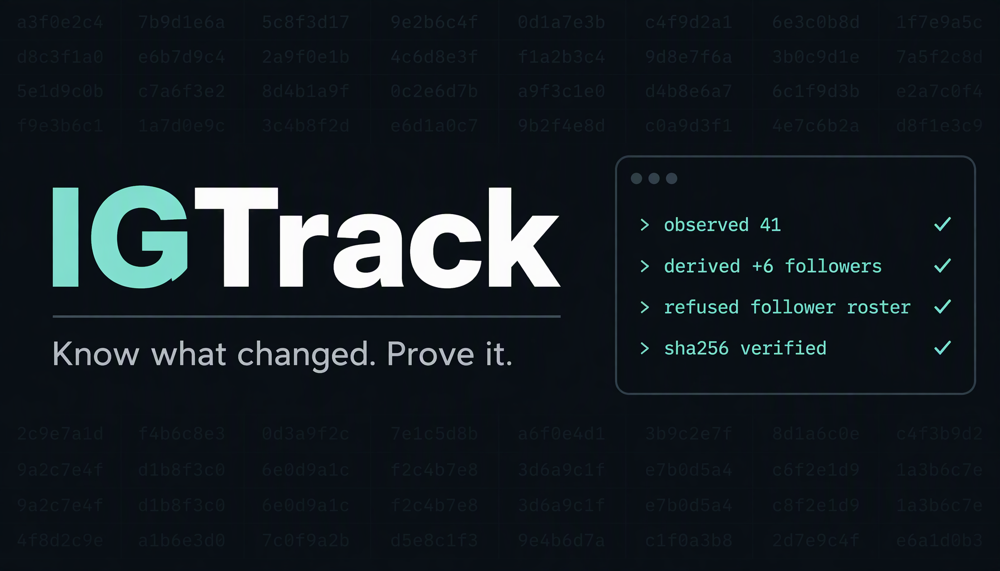

<div align="center">

# IGTrack

### Know what changed. Prove it.

**The open-source, evidence-first Instagram analytics engine for accounts you are authorized to observe.**
Self-hosted · Agent-native (MCP) · No telemetry · Free forever

[](https://github.com/AswinJava/igtrack/actions/workflows/ci.yml)
[](LICENSE)
[](package.json)
[](docs/FEATURES.md)
[](CONTRIBUTING.md)

[Quickstart](#quickstart-2-minutes) · [Why IGTrack](#why-igtrack) · [Features](#what-it-does) · [MCP](#use-it-from-your-ai-agent) · [Docs](#documentation) · [Roadmap](docs/ROADMAP.md)



</div>

```console
$ igtrack investigate @aurora.wilde

  Account      aurora.wilde · ig:17841400000000001 · public
  Observed     profile snapshot · 3 posts · 2 stories · comments · tagged media
  Derived      40 → 46 followers (+6) · 2 new relationships ranked
  Claims       3 cited findings from 2 independent domains
  Gaps         follower roster — UNAVAILABLE (no roster edge is exposed)
               story highlights — UNAVAILABLE (not in the logged-out payload)
  Evidence     41 observations · every row has a source id and SHA-256 hash
```

Every number above can be traced to an observation. Everything the platform does
not expose is reported **UNAVAILABLE with a reason** — never as zero, never as a
guess.

---

## Why IGTrack

Analytics tools usually answer one question badly: *"what changed?"* They show a
number, not where it came from. A count that was **never observable** looks
identical to a count that **is** zero, and a truncated read silently becomes a
"lost follower".

IGTrack inverts that. It is built around a simple contract:

> **Record what was observed, when, from which source, under which permission —
> and show absence as absence.**

Three properties follow from it:

- **Provenance on every row.** Source id, observation id, observed vs. captured
  time, confidence, and SHA-256 hashes in an append-only evidence ledger.
- **Partial data can never become a false claim.** Truncated scans are stored and
  labelled, but never diffed.
- **Refusals are first-class.** Rosters, liker lists, highlights and media bytes
  that the platform does not expose are named as unavailable, with the reason.

And because history is perishable by default, IGTrack's ledger is yours and
append-only. **Next month's diff answers questions a dashboard started next
month never could.**

## What it does

| | |
|---|---|
| **Investigate a handle end to end** | One command resolves the account, runs every stage the configured sources support, ranks relationships, retrieves public references and returns **one dossier**: what was investigated, what was actually retrieved, what was derived, what remains unknown, and why. |
| **Observe** | Profile, stories, story mentions, follower/following counts, posts, comments, carousels, tagged media, own-account insights (reach, views, engagement, demographics). Each observation carries source, time, confidence and hashes. |
| **Derive** | Follow deltas, profile changes, caption edits and post disappearances, story lifetimes, mention roll-ups, relationship rankings and insight series. Every derived row points at the observations it came from. |
| **Compose periods** | Weekly/monthly/quarterly reports from stored rows. Every section is `OBSERVED`, `DERIVED`, `EMPTY` or `UNAVAILABLE` — a window the rows cannot answer is a named gap. |
| **Audience & movement** | Mutuals, one-way follows and recent follow changes over **complete rosters only**, with first-seen times instead of invented follow timestamps. |
| **Cited research** | A claims ledger for findings your agent researches on the open web: closed predicate registry, source URL, excerpt, hash, and corroboration computed from stored rows. |
| **Run itself** | Postgres-backed queue (`FOR UPDATE SKIP LOCKED`, leases, heartbeats), resumable paged scans, checkpoints, retry classification and a per-target scheduler. |
| **Speak agent** | A JSON-first CLI and a stdio MCP server exposing the same operations — **38 tools**, one operations layer, no drift. |

### Honest by construction

```text
            observed                 derived                  refused
            ────────                 ───────                  ───────
profile     snapshot 12:00           +6 followers             follower *rosters*
stories     tray 12:00               new mention              liker lists
posts       media 12:00              caption edited           highlight contents
follows     page 1..3 COMPLETE       relationship rank        media bytes
comments    page 1..2 COMPLETE       (all with evidence)      repost identities
```

`igtrack capabilities` prints the full registry: **25 capabilities**, each with
its state, its supplier, and the reason when the answer is no.

## Quickstart (2 minutes)

**Requires:** Node ≥ 22, [pnpm](https://pnpm.io), and PostgreSQL 16 (Docker is
the easy path).

```bash
git clone https://github.com/AswinJava/igtrack.git
cd igtrack
pnpm install
cp .env.example .env        # local Postgres defaults already work
docker compose up -d        # Postgres 16 on localhost:5432

pnpm igtrack setup          # migrate + load the synthetic demo
pnpm igtrack investigate aurora.wilde
```

No database yet? `pnpm igtrack setup --local` uses the Compose database and
records the URL for you.

**Everything in the default path is synthetic fixture data** — deterministic,
offline, and legal to run forever. Every payload is labelled
`_meta.synthetic: true`, and a fixture set observes exactly the one account its
manifest declares, so demo data can never become evidence about a real person.

Then:

```bash
pnpm igtrack ask "what changed on aurora.wilde in the last 7 days?"
pnpm igtrack guide                 # a plain-language tour
pnpm igtrack status                # provider, targets, queue, source health
pnpm igtrack capabilities          # what can and cannot be observed
```

New to the project? [docs/USER-GUIDE.md](docs/USER-GUIDE.md) is the
non-technical tour: how to start it, what you can ask, how to read an answer,
and what it refuses to do.

## Use it from your AI agent

IGTrack is a stdio MCP server. Point Claude Code, Codex, Cursor, or any MCP
client at it:

```bash
claude mcp add igtrack -- node /absolute/path/to/igtrack/apps/cli/bin/igtrack.mjs mcp
```

Or in JSON form, for clients that take a config file:

```json
{
  "mcpServers": {
    "igtrack": {
      "command": "node",
      "args": ["/absolute/path/to/igtrack/apps/cli/bin/igtrack.mjs", "mcp"]
    }
  }
}
```

Then ask in plain language:

> *"Investigate @aurora.wilde and tell me what changed this week."*
> *"Who has she interacted with most, and what evidence supports it?"*
> *"Is there anything you cannot see about this account, and why?"*

`igtrack_ask` plans the operations from the sentence and returns what it
understood, every assumption, what ran, and the answer with evidence ids. The
agent can also call the 38 typed tools directly — `igtrack_investigate`,
`igtrack_dossier`, `igtrack_report`, `igtrack_audience`,
`igtrack_evidence_chain` and the rest. Destructive actions are never auto-run:
they come back as a suggested command for a human to confirm.

## Providers (lawful sources only)

| Provider | What it reads | Persists |
|---|---|---|
| `fixture:v1` | Deterministic synthetic data, labelled everywhere | Yes — safe forever |
| `graph` | Meta's official Instagram API, **owned** Business/Creator account | Yes |
| `import:v1` | Your **own** Instagram data export | Yes — real rosters, lawfully |
| `public` | Logged-out public profile, post and reels pages rendered in local headless Chrome | Opt-in, labelled `PUBLIC_WEB` |
| `anonstories` | Login-free story/highlight contents via a third-party aggregator, in a local Chrome page context | Opt-in, labelled `PUBLIC_AGGREGATOR` |
| research engine | Bounded public-web acquisition you name, with SSRF guards and a closed predicate registry | Cited claims |

IGTrack does **not** use session cookies, undocumented endpoints, private-account
access, or browser automation against authenticated surfaces. If a capability has
no lawful source, the product says so.

Live (optional) observation uses the **official Instagram Graph API against your
own Business/Creator account**. Set `IGTRACK_PROVIDER=graph` plus the
`IGTRACK_GRAPH_*` credentials in `.env`, then `igtrack doctor` confirms the
provider before anything is queued. See [docs/DEPLOY.md](docs/DEPLOY.md).

## How it is built

```text
                  ┌──────────────────────────────────────────┐
  agent ── MCP ──▶│  apps/cli   operations layer + renderers  │
  human ── CLI ──▶│  one implementation, two surfaces         │
                  └────────────────┬─────────────────────────┘
                                   ▼
                  ┌──────────────────────────────────────────┐
                  │  packages/database   schema · repos · queue │
                  └────────────────┬─────────────────────────┘
                                   ▲
                  ┌────────────────┴─────────────────────────┐
                  │  workers/monitoring  claim → execute →    │
                  │  complete · checkpoints · scheduler       │
                  └────────────────┬─────────────────────────┘
                                   ▼
                  ┌──────────────────────────────────────────┐
                  │  packages/ingestion   providers · parsers │
                  └────────────────┬─────────────────────────┘
                                   ▼
                  ┌──────────────────────────────────────────┐
                  │  packages/core   models · epistemics ·    │
                  │  capability registry · diffs (no deps)    │
                  └──────────────────────────────────────────┘
```

Dependencies point downward only. `packages/core` has **zero runtime
dependencies**, so the epistemic rules are testable in isolation and cannot be
quietly re-implemented in a UI.

| Path | What it is |
|---|---|
| `packages/core` | Observation categories, `CapabilityResult`, typed errors with retryability, evidence hashing, diffs, mention classification, capability registry. |
| `packages/database` | Drizzle schema, repositories, append-only evidence ledger, job queue, scheduler primitives, migrations, synthetic seed. |
| `packages/ingestion` | Providers, normalizers, SSR/page parsers, fixtures and the research acquisition engine. |
| `workers/monitoring` | Claim → execute → complete, per-kind executors, checkpoints, lease heartbeats, timeouts, retention. |
| `apps/cli` | The `igtrack` CLI and the `igtrack mcp` server. |

Read [docs/ARCHITECTURE.md](docs/ARCHITECTURE.md) for the data flow and the
invariants that hold it together.

## Verify it yourself

```bash
pnpm typecheck      # every package
pnpm test           # unit + integration against real PostgreSQL
pnpm verify:graph   # one-node probe for the live Graph fields
```

Live Graph paths are documentation-pinned and marked `NOT_VERIFIED` in the
capability matrix until you run them against your own account. The fixture path,
the queue, the evidence ledger and every refusal are covered by the test suite.

## Documentation

| Document | Read it for |
|---|---|
| [User guide](docs/USER-GUIDE.md) | The non-technical tour: start it, ask questions, read an answer. |
| [Architecture](docs/ARCHITECTURE.md) | Layers, pipeline, epistemics, failure modes, extension points. |
| [Feature reference](docs/FEATURES.md) | Every command, tool, provider and configuration variable. |
| [Capability matrix](docs/CAPABILITIES.md) | All 25 capabilities, their state and their source. |
| [Deployment](docs/DEPLOY.md) | Local, container, cron, backups, production checklist. |
| [Roadmap](docs/ROADMAP.md) | What is next and what is deliberately out of scope. |
| [Contributing](CONTRIBUTING.md) | The one rule that matters, and where to change what. |
| [Security](SECURITY.md) | Reporting a vulnerability and the threat model. |
| [AGENTS.md](AGENTS.md) | Invariants for AI coding agents working in this repo. |

## Non-goals

- Monitoring accounts you do not own or are not authorized to observe.
- Private-account access, session-cookie scraping, story/highlight proxies,
  media download pipelines.
- Follower rosters for arbitrary accounts, liker lists, interaction feeds,
  repost attribution — the platform does not expose them, and inferring them
  locally would be dishonest.
- Hosted multi-tenant SaaS, billing, seats, or a paid tier. Ever.
- AI inference that launders speculation into "findings". If it was not
  observed or derived from observations, it is not shown.

## Contributing

The one rule: **honesty about what is observable beats every other feature.**
Read [CONTRIBUTING.md](CONTRIBUTING.md) before opening a PR. Security reports go
through [SECURITY.md](SECURITY.md), never a public issue.

If IGTrack saves you time, a star helps other people find it.

## License

**AGPL-3.0-or-later.** Use it, self-host it, modify it, build on it. If you run a
modified version as a network service, publish your changes — see [LICENSE](LICENSE).

<div align="center">

Built for people who need to prove what changed.

<sub>© 2026 Aswin S · AGPL-3.0-or-later</sub>

</div>
